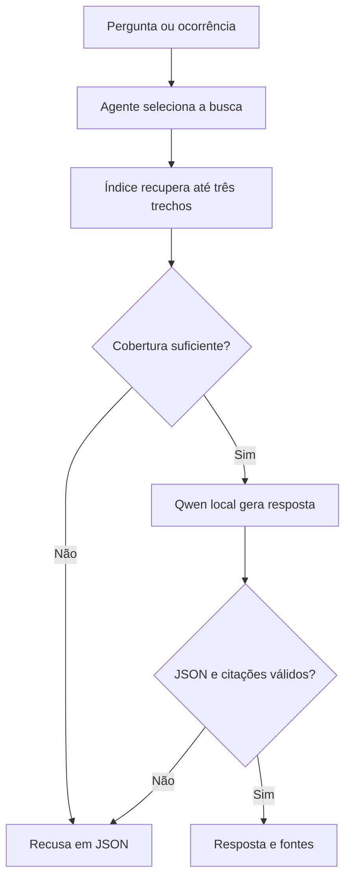

# Generative AI for Engineering — Pátio Monitor

- Gabriel Teixeira Machado · RM551570
- Felipe Bressani · RM97688
- Camila do Prado Padalino · RM98316

O assistente orienta a revisão de uma saída de garagem. A saída inclui uma resposta curta, IDs e URLs das fontes e um indicador de recusa. Um caso estruturado informa o motivo da ocorrência e distingue o cenário DEMO de registros CSV locais. A explicação descreve o procedimento, e a conclusão continua sob responsabilidade de quem revisa o turno.

[Repositório](https://github.com/MachadONLY/patio-monitor-ia-generativa) · [Vídeo da demonstração](genai/demonstracao.mp4) · [Captura da ocorrência com fonte](genai/ocorrencia-com-fontes.png)

## Dados e arquitetura

O [corpus](../../services/api/app/assistant_data/corpus.json) reúne dez trechos UTF-8 com `id`, título, URL, direitos e conteúdo. As unidades correspondem a tópicos operacionais completos, oito originais do projeto e dois resumidos a partir da documentação pública do Olho Vivo. Os direitos de republicação do texto oficial não foram identificados. A base contém paráfrases próprias e aponta para a publicação oficial. [Documentação do Olho Vivo](https://www.sptrans.com.br/desenvolvedores/api-do-olho-vivo-guia-de-referencia/documentacao-api/)

O [gabarito](../../gs/genai/gold.json) tem 17 perguntas, onze respondíveis e seis sem evidência. Um conjunto separado de [calibração](../../gs/genai/calibration.json) inclui sete casos respondíveis e cinco desconhecidos. Ambos acompanham respostas esperadas ou fontes relevantes. O conjunto principal também contém padrões de correção lexical.

O recuperador remove acentos e palavras funcionais, aplica aliases simples de domínio e mede a fração ponderada dos termos da consulta presentes em cada trecho, com peso inverso à frequência documental. Consultas sem correspondência mantêm peso no denominador. O resultado é uma cobertura lexical entre zero e um. O agente escolhe a busca com base no contexto, invoca a recuperação, decide sobre a recusa e valida citações e números antes de publicar o JSON.

Em perguntas livres de alta cobertura, o agente permite uma resposta composta exclusivamente de um trecho recuperado. Essa trilha exige cobertura a partir de 0,68 e uma diferença de pelo menos 0,16 para o segundo lugar. Uma ocorrência tipada usa o procedimento mais relacionado ao seu motivo. O modelo escolhe frases ou pares contíguos de frases do trecho. A aplicação valida fontes e recusa antes de devolver a resposta.

## Protocolo

As três configurações usam o mesmo peso **Qwen2.5-0.5B-Instruct Q4_K_M**, licença Apache 2.0, CPU e `llama-cpp-python 0.3.36`. A avaliação registra temperatura zero, seed 42, metadados do peso e SHA-256. As execuções foram realizadas em Linux com uma thread por instância. [Ficha oficial do modelo](https://huggingface.co/Qwen/Qwen2.5-0.5B-Instruct-GGUF)

- **LLM sem contexto** responde a partir dos pesos do modelo e usa o mesmo esquema de campos do JSON.
- **RAG** fornece ao modelo os trechos com cobertura positiva. A saída passa por validação de estrutura e associação a fontes recuperadas.
- **RAG com agente** acrescenta busca orientada ao caso, limiar de evidência, seleção extrativa quando a evidência é forte e validação numérica.

A calibração escolheu **0,46** como o menor limiar testado que bloqueou quatro dos cinco casos desconhecidos sem remover nenhum dos sete respondíveis. Em 0,34–0,44, três desconhecidos eram bloqueados. Em 0,52, o limite bloqueou os cinco desconhecidos e suprimiu um caso respondível. A calibragem é de demonstração e depende deste corpus.

A correção semântica usa padrões lexicais predefinidos e a recusa quando o gabarito não tem fonte. Esse critério pode penalizar paráfrases incompletas, e recuperar a fonte correta não garante que a resposta use a frase adequada. Cobertura do recuperador e geração são medidas separadamente.

## Resultados

A recuperação obteve **Recall@1 100%** e **Recall@3 100%** sobre as 11 perguntas do gabarito com fonte. O conjunto é pequeno e escrito para o domínio. Casos sem fonte foram medidos pela taxa de recusa.

| Configuração | Acertos | Respondíveis | Recusas corretas | Corretas com fonte pertinente | JSON da LLM | Mediana CPU |
|---|---:|---:|---:|---:|---:|---:|
| LLM sem contexto | 4/17 | 0/11 | 4/6 | 0/11 | 17/17 | 1.807 s |
| RAG | 8/17 | 2/11 | 6/6 | 2/11 | 17/17 | 6.076 s |
| RAG com agente | 10/17 | 5/11 | 5/6 | 5/11 | 13/13 | 4.794 s |

Todas as configurações devolveram 17 objetos JSON válidos. A métrica de JSON da LLM conta só as chamadas efetivas. O agente recusou quatro consultas antes de gerar. A latência foi observada neste ambiente e pode variar com hardware e carga. A comparação confirma ganho de resposta fundamentada com o agente neste conjunto. O RAG simples recusou corretamente um caso a mais. A cobertura alta do recuperador deslocou o principal gargalo para a escolha de conteúdo e para a separação de assuntos aproximados.

Na ocorrência tipada g17, a LLM selecionou o procedimento de portaria `p01` e informou que o operador deve conferir registro OUT, veículo e horário. Essa chamada é reproduzível com os mesmos arquivos e os pesos registrados.

## Erros observados

| Caso real do gabarito | Resposta observada | Falha e próximo ajuste |
|---|---|---|
| g01 · GPS sozinho comprova passagem? | O agente explicou a ausência de vínculo na portaria | A frase escolhida omitiu a limitação do GPS. A próxima revisão pode exigir que o trecho contenha a entidade central da pergunta. |
| g04 · A partir de qual atraso? | O agente devolveu a regra de cinco minutos de antecedência | A recuperação achou a regra correta no mesmo trecho, mas a geração confundiu a direção temporal. Separar antecedência de atraso em trechos com títulos próprios. |
| g05 · Qual modo é sintético e qual exige leitura real? | O agente respondeu apenas que DEMO usa cenário sintético | A segunda parte ficou sem resposta. Dividir pergunta composta em subconsultas e exigir evidência para cada parte. |
| g09 · O que representam py e px? | O agente escolheu a frase sobre as limitações de passagem e vaga | O trecho correto continha assuntos diferentes. Separar a tabela de campos da API das limitações. |
| g12 · Senha do motorista | O agente respondeu com o endpoint de autenticação do Olho Vivo | O alias `senha → token` aproximou credenciais distintas. Remover a equivalência e acrescentar testes fora de escopo para credenciais e dados de terceiros. |

O limite de citação valida que o ID pertence ao conjunto recuperado. Uma citação válida por si só ainda pode sustentar uma resposta insuficiente. O conjunto de avaliação e os cinco erros dão os pontos para a próxima iteração.

## Reprodutibilidade

[README da trilha](../../gs/genai/README.md) · [Notebook com saídas](../../gs/genai/avaliacao.ipynb) · [Saídas e métricas JSON](../../gs/genai/evaluation.json) · [Executor de avaliação](../../gs/genai/evaluate.py) · [Manifesto do peso](../../gs/genai/model.json)
