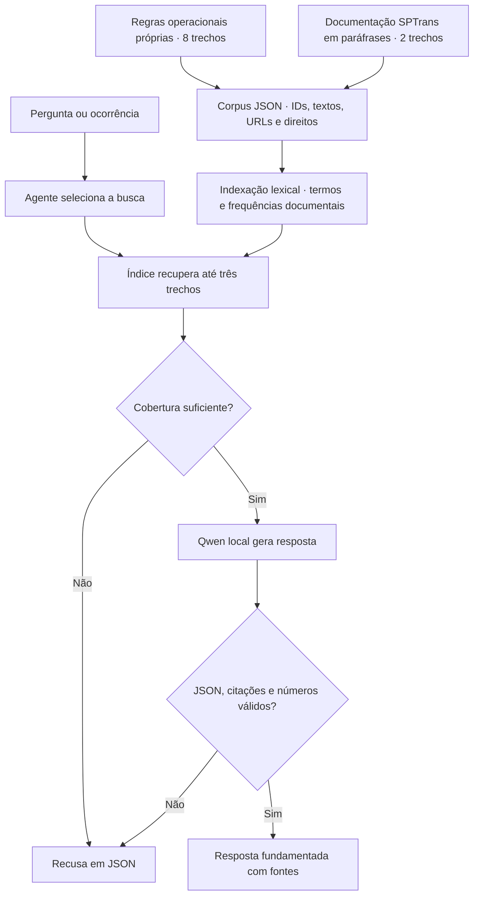

# Generative AI for Engineering — Pátio Monitor

- Gabriel Teixeira Machado · RM551570
- Felipe Bressani · RM97688
- Camila do Prado Padalino · RM98316

O assistente orienta a revisão de uma saída de garagem. A saída inclui uma resposta curta, IDs e URLs das fontes e um indicador de recusa. Um caso estruturado informa o motivo da ocorrência e distingue o cenário DEMO de registros CSV locais. A explicação descreve o procedimento, e a conclusão continua sob responsabilidade de quem revisa o turno.

[Repositório](https://github.com/MachadONLY/patio-monitor-ia-generativa) · [Vídeo — teste real no navegador](genai/demonstracao-navegador-real.mp4) · [Apresentação complementar](genai/demonstracao.mp4) · [Captura da execução real com o Qwen](genai/prova-qwen-real.png)

## Ficha técnica

| Campo | Aplicação |
|---|---|
| Tarefa | Orientar a revisão de divergências entre escala e portaria de ônibus. |
| Entrada | Pergunta curta e, na interface, o tipo da ocorrência e a origem do caso. |
| Saída | Orientação de revisão com fontes ou recusa em JSON. |
| Execução | Qwen2.5-0.5B-Instruct quantizado em CPU, FastAPI e recuperação local. |
| Decisão operacional | O operador confere as evidências e registra a conclusão. |

## Dados e arquitetura

O [corpus](../../services/api/app/assistant_data/corpus.json) reúne dez trechos UTF-8 com `id`, título, URL, direitos e conteúdo. As unidades correspondem a tópicos operacionais completos, oito originais do projeto e dois resumidos a partir da documentação pública do Olho Vivo. Os direitos de republicação do texto oficial não foram identificados. A base contém paráfrases próprias e aponta para a publicação oficial. [Documentação do Olho Vivo](https://www.sptrans.com.br/desenvolvedores/api-do-olho-vivo-guia-de-referencia/documentacao-api/)

| Fonte | Formato consumido | Licença / direitos do conteúdo | Trechos |
|---|---|---|---:|
| Regras operacionais do Pátio Monitor | UTF-8 em JSON | Texto original do projeto, uso acadêmico autorizado pelo projeto | 8 |
| Documentação oficial da SPTrans Olho Vivo | Paráfrases originais em UTF-8 e JSON | Texto oficial referenciado, licença de republicação do original não identificada | 2 |

O [gabarito](../../gs/genai/gold.json) tem 17 perguntas, onze respondíveis e seis sem evidência. Um conjunto separado de [calibração](../../gs/genai/calibration.json) inclui sete casos respondíveis e cinco desconhecidos. Ambos acompanham respostas esperadas ou fontes relevantes. O conjunto principal também contém padrões de correção lexical.



O recuperador remove acentos e palavras funcionais, aplica aliases simples de domínio e mede a fração ponderada dos termos da consulta presentes em cada trecho, com peso inverso à frequência documental. Consultas sem correspondência mantêm peso no denominador. O resultado é uma cobertura lexical entre zero e um. O agente escolhe a busca com base no contexto, invoca a recuperação, decide sobre a recusa e valida citações e números antes de publicar o JSON.

Em perguntas livres de alta cobertura, o agente permite uma resposta composta exclusivamente de um trecho recuperado. Essa trilha exige cobertura a partir de 0,68 e uma diferença de pelo menos 0,16 para o segundo lugar. Uma ocorrência tipada usa o procedimento mais relacionado ao seu motivo. O modelo escolhe frases ou pares contíguos de frases do trecho. A aplicação valida fontes e recusa antes de devolver a resposta.

O experimento usa um corpus fixo para permitir a reprodução das métricas. Nele, o trecho `p05` descreve o LIVE com o Olho Vivo. Na plataforma, o LIVE também pode consultar o feed público do BRT do Rio sem autenticação. A fonte ativa aparece no painel e na [documentação dos modos](../../README.md#modos-de-dados).

## Protocolo

As três configurações usam o mesmo peso **Qwen2.5-0.5B-Instruct Q4_K_M**, licença Apache 2.0, CPU e `llama-cpp-python 0.3.36`. A avaliação registra temperatura zero, seed 42, metadados do peso e SHA-256. As execuções foram realizadas em Linux com uma thread por instância. [Ficha oficial do modelo](https://huggingface.co/Qwen/Qwen2.5-0.5B-Instruct-GGUF)

- **LLM sem contexto** responde a partir dos pesos do modelo e usa o mesmo esquema de campos do JSON.
- **RAG** fornece ao modelo os trechos com cobertura positiva. A saída passa por validação de estrutura e associação a fontes recuperadas.
- **RAG com agente** acrescenta busca orientada ao caso, limiar de evidência, seleção extrativa quando a evidência é forte e validação numérica.

A calibração escolheu **0,46** como o menor limiar testado que bloqueou quatro dos cinco casos desconhecidos sem remover nenhum dos sete respondíveis. Em 0,34–0,44, três desconhecidos eram bloqueados. Em 0,52, o limite bloqueou os cinco desconhecidos e suprimiu um caso respondível. A calibragem é de demonstração e depende deste corpus.

A correção semântica usa padrões lexicais predefinidos e a recusa quando o gabarito não tem fonte. Esse critério pode penalizar paráfrases incompletas, e recuperar a fonte correta não garante que a resposta use a frase adequada. Cobertura do recuperador e geração são medidas separadamente.

## Resultados

A recuperação obteve **Recall@1 100%** e **Recall@3 100%** sobre as 11 perguntas do gabarito com fonte. O conjunto é pequeno e escrito para o domínio. Casos sem fonte foram medidos pela taxa de recusa.

| Configuração | Acertos | Respondíveis | Recusas corretas | Corretas com fonte pertinente | JSON da LLM | Mediana CPU |
|---|---:|---:|---:|---:|---:|---:|
| LLM sem contexto | 4/17 | 0/11 | 4/6 | 0/11 | 17/17 | 1.605 s |
| RAG | 8/17 | 2/11 | 6/6 | 2/11 | 17/17 | 4.868 s |
| RAG com agente | 11/17 | 5/11 | 6/6 | 5/11 | 12/12 | 4.007 s |

Todas as configurações devolveram 17 objetos JSON válidos. A métrica de JSON da LLM conta só as chamadas efetivas. O agente recusou cinco consultas antes de gerar. A latência foi observada neste ambiente e pode variar com hardware e carga. O agente teve três acertos totais a mais que o RAG simples. Nos seis casos sem fonte, o modelo sem contexto respondeu indevidamente a dois, o RAG simples e o agente recusaram todos. Nas onze perguntas com fonte, as três configurações emitiram, respectivamente, quatro, cinco e seis respostas incorretas pelo critério lexical. Esses números distinguem respostas indevidas sem fonte de erros em perguntas respondíveis. A cobertura alta do recuperador deslocou o principal gargalo para a escolha de conteúdo e para a separação de assuntos aproximados.

Na ocorrência tipada g17, a LLM selecionou o procedimento de portaria `p01` e informou que o operador deve conferir registro OUT, veículo e horário. Essa chamada é reproduzível com os mesmos arquivos e os pesos registrados.

## Auditoria objetiva dos critérios 3, 4 e 5 da rubrica

Para tornar verificáveis as evidências quantitativas além das capturas de tela, o repositório inclui um [verificador de resultados e contratos](../../gs/genai/audit_rubric.py), executado em [GitHub Actions](https://github.com/MachadONLY/patio-monitor-ia-generativa/actions/runs/44642516037). Esse teste confronta os resultados armazenados com os 17 IDs do gabarito, o corpus e o manifesto do peso; não produz inferências novas. A [reprodução independente das 51 inferências reais](https://github.com/MachadONLY/patio-monitor-ia-generativa/actions/runs/44637894029), com o GGUF oficial baixado e SHA-256 validado, é a evidência complementar de execução efetiva.

**Critério 3 — recuperação e corte.** Os 11 casos respondíveis do gabarito recuperaram a fonte esperada na primeira posição e entre as três primeiras: Recall@1 = **11/11 (100%)** e Recall@3 = **11/11 (100%)**. O limiar **0,46** foi calibrado separadamente em 12 perguntas: preservou **7/7** casos respondíveis e bloqueou **4/5** consultas sem evidência. Não é uma alegação de desempenho geral fora dessas amostras.

**Critério 4 — contrato de geração fundamentada, JSON e recusa.** O FastAPI devolveu **17/17 objetos JSON válidos em cada configuração** (**51/51** no total). As saídas brutas efetivamente geradas pela LLM também eram JSON válido em **17/17 chamadas sem contexto, 17/17 com RAG e 12/12 chamadas no agente**. O agente não invocou o modelo em cinco perguntas que recusou antecipadamente por ausência de evidência; essas cinco recusas não entram na contagem de gerações brutas da LLM. As seis consultas sem fonte receberam `refused: true` e `citations: []` na saída final do agente. IDs das citações retornadas são verificados contra os documentos recuperados e a estrutura da API é validada com Pydantic. O teste funcional reproduz um caso com fonte `p02` no [vídeo gravado do navegador](genai/demonstracao-navegador-real.mp4).

**Critério 5 — especialização como agente (sem LoRA).** As três configurações usam **o mesmo modelo, peso, gabarito e método de avaliação**. A especialização por agente acrescenta escolha de consulta conforme a ocorrência, chamada ao recuperador, limiar de recusa, restrição a fonte de alta confiança, validação de citação e checagem de números antes de publicar o resultado. A rastreabilidade é registrada no campo `actions` de cada ocorrência. O resultado passou de **8/17 no RAG simples para 11/17 no RAG com agente**, acréscimo de três acertos neste conjunto; a configuração sem contexto fez 4/17. O agente é uma orquestração determinística com o modelo Qwen local, não um treino de novos pesos nem uma implementação LoRA. A rubrica permite a escolha entre LoRA ou agente.

Para reproduzir a conferência dos dados salvos a partir da raiz do repositório, sem baixar o modelo:

```sh
python gs/genai/audit_rubric.py --out gs/genai/rubric-audit.json
```

Para refazer a **inferência real** das 51 perguntas, use `python gs/genai/evaluate.py` após instalar o runtime e baixar o GGUF conforme o [guia](../../gs/genai/README.md).

## Erros observados

A tabela registra cinco erros observados na execução atual e uma regressão corrigida nesta versão.

| Caso real do gabarito | Resposta observada | Falha e próximo ajuste |
|---|---|---|
| g01 · GPS sozinho comprova passagem? | O agente explicou a ausência de vínculo na portaria | A frase escolhida omitiu a limitação do GPS. A próxima revisão pode exigir que o trecho contenha a entidade central da pergunta. |
| g04 · A partir de qual atraso? | O agente devolveu a regra de cinco minutos de antecedência | A recuperação achou a regra correta no mesmo trecho, mas a geração confundiu a direção temporal. Separar antecedência de atraso em trechos com títulos próprios. |
| g05 · Qual modo é sintético e qual exige leitura real? | O agente respondeu apenas que DEMO usa cenário sintético | A segunda parte ficou sem resposta. Dividir pergunta composta em subconsultas e exigir evidência para cada parte. |
| g08 · Quando a posição é considerada desatualizada? | O agente citou a origem dos horários de observação e recepção. | A frase não informou o limite de 90 segundos. Separar a definição de frescor da semântica dos dois campos de data. |
| g09 · O que representam py e px? | O agente escolheu a frase sobre as limitações de passagem e vaga | O trecho correto continha assuntos diferentes. Separar a tabela de campos da API das limitações. |
| g12 · Senha do motorista | Na execução anterior, o agente respondeu com o endpoint de autenticação do Olho Vivo | Na execução anterior, o alias `senha → token` aproximava credenciais distintas. A remoção da equivalência, coberta por teste, fez o agente recusar esse caso antes de chamar o modelo. |

O limite de citação valida que o ID pertence ao conjunto recuperado. Uma citação válida por si só ainda pode sustentar uma resposta insuficiente. O conjunto de avaliação e os cinco erros dão os pontos para a próxima iteração.

## Validação funcional da integração

No Pátio Monitor, selecione **Iniciar teste guiado → Abrir caso de exemplo → Ir para a explicação → Explicar ocorrência**. O caso demonstrativo mostra a divergência documental entre os veículos `8 2361` e `7 8042`, identificada pelas regras de conciliação. A chamada à LLM local acrescenta a orientação e o trecho `p02` consultado; a fonte utilizada fica disponível na própria interface. A captura da execução sem resposta simulada está em [prova-qwen-real.png](genai/prova-qwen-real.png). O [teste de aceitação com inferência real](../../apps/web/tests/release-real-e2e.spec.ts) registra esse fluxo. Essa demonstração não confirma uma troca física de ônibus.

## Conclusão técnica

A opção adotada para especialização foi o **agente**, alternativa prevista na rubrica ao lado de LoRA. O Qwen é um modelo pré-treinado executado localmente em CPU: não houve ajuste de pesos, fine-tuning nem treinamento de uma LoRA pela equipe. O ganho observado é atribuído às mudanças no fluxo de recuperação, decisão e validação, mantendo o mesmo peso nas três configurações.

Usar recuperação e agente elevou a correção de 4 para 11 perguntas em 17 em relação ao modelo sem contexto. Os seis pedidos sem evidência foram recusados. Nas perguntas respondíveis, os principais erros vieram da seleção de frases incompletas ou de regras próximas no mesmo trecho. O fluxo de revisão envia ao modelo uma categoria de ocorrência e preserva a decisão no navegador. A próxima validação deve medir a qualidade em perguntas novas e em ocorrências autorizadas de uma garagem.

**Links para a entrega:** [repositório público](https://github.com/MachadONLY/patio-monitor-ia-generativa) · [vídeo do teste real](genai/demonstracao-navegador-real.mp4) · [apresentação complementar](genai/demonstracao.mp4) · [plataforma pública](https://patio-monitor-production.up.railway.app/) · [guia de validação e reprodutibilidade](../../ROTEIRO_AVALIACAO_IA.md).

## Reprodutibilidade

[README da trilha](../../gs/genai/README.md) · [Notebook com saídas](../../gs/genai/avaliacao.ipynb) · [Saídas e métricas JSON](../../gs/genai/evaluation.json) · [Executor de avaliação](../../gs/genai/evaluate.py) · [Manifesto do peso](../../gs/genai/model.json)
