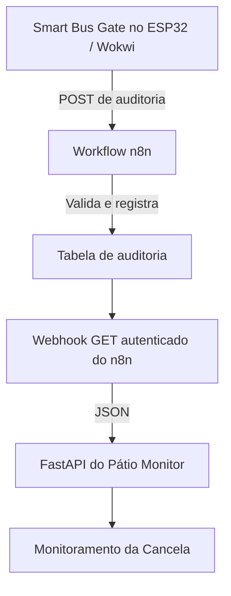

# Monitoramento da Cancela · Robotic Process Automation

FIAP · Global Solution 2026.2 · CitizenTech

| Integrante | RM |
|---|---|
| Camila do Prado Padalino | 98316 |
| Felipe Cavalcante Bressane | 97688 |
| Gabriel Teixeira Machado | 551570 |

O Smart Bus Gate gera eventos de abertura, fechamento e possíveis ocorrências a partir dos sensores do protótipo. O n8n aplica as regras, registra a auditoria em Data Tables e devolve o histórico pela API de consulta. No Pátio Monitor, o operador consegue conferir quando a cancela registrou cada transição e revisar a ocorrência usando o horário, dispositivo, distância e movimento.

[Automação de RPA, exportação, fluxograma, logs e testes](https://github.com/camilapadalino/RPABusGate_PatioMonitorGS2026) · [ESP32 e circuito do Smart Bus Gate](https://github.com/camilapadalino/SmartBusGate_PatioMonitorGS26)

## Caminho dos eventos

O [repositório de RPA](https://github.com/camilapadalino/RPABusGate_PatioMonitorGS2026) contém as regras e a exportação em `N8N/`. A interface consulta `GET /api/rpa/gate-events` no próprio domínio do MVP. O FastAPI usa `RPA_API_URL` e `RPA_API_KEY` para a consulta autenticada. A API devolve `status`, `checked_at`, `total` e `eventos`, preservando os IDs de auditoria. O servidor valida tipos, totais e horários e ordena por instante e ID.

O painel agrupa e apresenta os horários no fuso de Brasília. Mantém a procedência do protótipo, inclusive quando o GPS da tela principal usa o feed do BRT do Rio. Uma abertura registrada é um evento da cancela. Ela não vincula o registro a um prefixo e não confirma uma passagem operacional. A integração é de leitura. A decisão de abrir ou fechar a cancela fica no ESP32.

O webhook publicado na exportação consulta a tabela de auditoria. A automação também registra possíveis obstruções em uma tabela de alertas. Os indicadores do painel contam apenas os eventos da resposta de consulta.

## Operação e falhas

- Uma consulta bem-sucedida exibe o horário da atualização, o estado registrado, os gráficos, os indicadores e a tabela.
- Uma consulta vazia exibe zero registros e o estado indisponível.
- Se a atualização falhar após uma consulta bem-sucedida, o painel mantém a última resposta na memória e informa a falha.
- Se a primeira consulta falhar, o painel informa que o histórico está indisponível e permite nova tentativa.
- Quando o servidor está sem credencial, o painel informa que a integração ainda exige configuração.

A atualização automática ocorre a cada 30 segundos com a tela visível. O backend agrupa requisições próximas, limita o tempo e o tamanho das respostas e registra apenas o tipo de erro ou o status HTTP. A publicação deve incluir somente eventos autorizados para a demonstração da equipe, sem dados pessoais.

## Testar para a correção

1. Configure o endpoint de produção e a chave no servidor, seguindo o [guia de execução](../../../deploy/README.md).
2. Em uma janela anônima, abra a URL do MVP com `?cancela=1`. Confira o horário da atualização e o dispositivo.
3. Gere uma abertura ou fechamento no protótipo. Localize a nova linha na tabela do n8n.
4. Clique em **Atualizar dados** e compare o ID na tabela, tipo, dispositivo e hora do evento com o n8n. Confira a alteração de contagem. O último estado muda quando o evento registra uma abertura ou um fechamento mais recente.
5. Demonstre uma entrada inválida ou falha no fluxo de teste do n8n. O histórico exibido deve conservar os registros válidos. Use um ambiente de teste para os cenários de falha.

O teste da API roda com `(cd services/api && python -m pytest -q tests/test_gate_monitor.py)`. O teste de navegador roda com `pnpm --filter @patio/web exec playwright test tests/gate-monitor.spec.ts`, após o build e a instalação do Chromium do Playwright. Os testes automatizados usam respostas controladas para exercitar a inclusão de um evento novo, ausência de registros, validação, tratamento de falha, filtros e apresentação do horário.

## Materiais para o Teams

A rubrica de RPA está nas páginas 46–50 do enunciado. O PDF técnico inclui integrantes, mapeamento do processo, regras, exceções, LGPD, testes e evidência de integração. O vídeo de até três minutos mostra o fluxo em execução, uma decisão ou falha tratada e o evento aparecendo no MVP. O PDF deve trazer os links do vídeo e do repositório de RPA. Use a mesma URL pública do MVP nas entregas do grupo.
